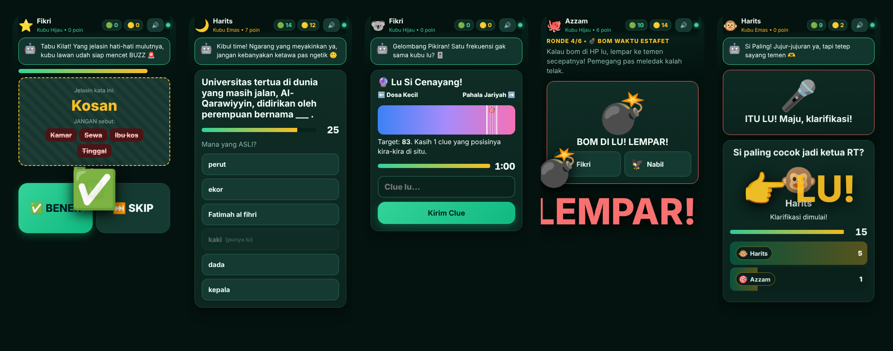
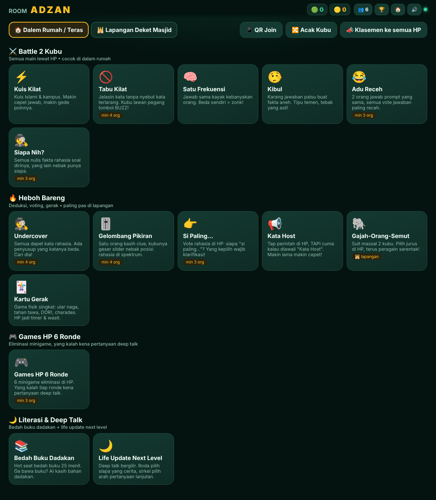
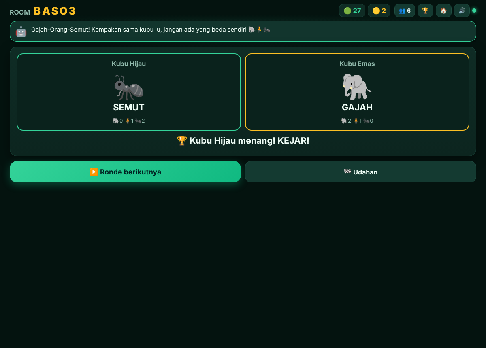
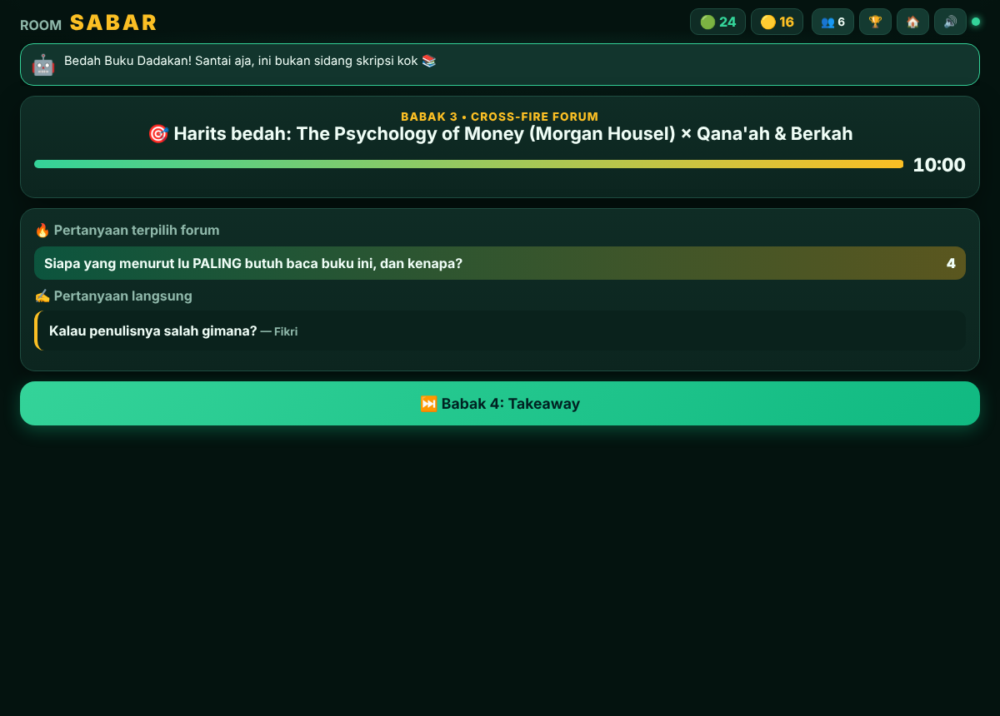

# 🎮 SIGMAGENK ARENA

### Party game realtime buat sirkel lu. Cukup HP, nol properti, heboh maksimal.

**[▶️ Main sekarang di sigmagenk-arena.netlify.app](https://sigmagenk-arena.netlify.app)**

---

Kumpul bareng 10–20 orang tapi bingung mau ngapain? Buka Sigmagenk Arena di laptop, semua scan QR, dan dalam 30 detik satu ruangan udah teriak-teriak rebutan jawaban.

Ga perlu beli balon, spidol, atau kartu. **Modalnya cuma badan, suara, dan HP masing-masing.** HP lu jadi kartu rahasia, tombol buzzer, alat voting, timer, sekaligus papan skor, semuanya sinkron realtime.

## ✨ Kenapa beda

- **⚡ Ngebut.** Jawaban lu nyampe ke layar semua orang dalam sekejap. Timer jalan pake jam server, jadi semua HP hitung mundur bareng.
- **📱 Semua ikut main.** Ga ada yang cuma nonton. Bahkan pas giliran orang lain, lu tetep pegang tombol BUZZ, voting, atau nebak.
- **🟢🟡 Perang 2 kubu.** Tiap poin individu nyumbang ke skor kubu. Klasemen bisa ditembak ke semua HP kapan aja.
- **🔊 Rame beneran.** Efek suara, getar, confetti, dan reaksi emoji 😂🔥🤲 yang terbang di layar semua orang.
- **🤖 Ada AI Game Master.** Gemini bantu bikin pertanyaan bedah buku dan pertanyaan lanjutan deep talk yang nyambung sama cerita lu.
- **🕌 Hangat & beradab.** Konten dikurasi buat sirkel mahasiswa: kocak, tapi tetap sopan dan Islami.

## 🕹️ 15 game, 4 mood

### ⚔️ Battle 2 Kubu: buat di dalem rumah
| | Game | Serunya |
|---|---|---|
| ⚡ | **Kuis Kilat** | Kuis Islami & kampus. Makin cepet jawab, makin gede poin. Bener beruntun = bonus streak 🔥 |
| 🚫 | **Tabu Kilat** | Jelasin kata tanpa nyebut kata terlarang. Kubu lawan pegang tombol 🚨 BUZZ di HP-nya. |
| 🧠 | **Satu Frekuensi** | Jawab sama kayak mayoritas. Yang sok unik sendirian = zonk. |
| 🤥 | **Kibul** | Karang jawaban palsu buat fakta aneh. Tipu temen, tebak yang asli. |
| 😂 | **Adu Receh** | Dua orang jawab prompt yang sama, satu ruangan vote yang paling receh. |
| 🕵️ | **Siapa Nih?** | Semua nulis fakta rahasia soal dirinya. Seberapa kenal lu sama sirkel ini? |

### 🔥 Heboh Bareng: deduksi, voting, gerak
| | Game | Serunya |
|---|---|---|
| 🕵️ | **Undercover** | Ada penyusup dengan kata yang beda. Plus Mr. White yang layarnya kosong. Cari mereka! |
| 🎚️ | **Gelombang Pikiran** | Satu orang kasih clue, kubunya geser slider nebak posisi rahasia di spektrum. |
| 👉 | **Si Paling...** | Vote rahasia "si paling telat bales chat?". Yang kepilih wajib klarifikasi 15 detik. |
| 📢 | **Kata Host** | Tap perintah cuma kalau diawali "Kata Host". Makin lama makin cepet. Jempol jangan gatel! |
| 🐘 | **Gajah-Orang-Semut** | Suit massal 2 kubu. Pilih jurus di HP, terus peragain serentak dan kejar-kejaran! |
| 🃏 | **Kartu Gerak** | Ular naga, duel tahan tawa, DOR!, charades. HP jadi wasit & timer. |

### 🎮 Games HP 6 Ronde: eliminasi
Enam minigame beruntun: **Kumpul Kode Teman → Lampu Merah-Hijau → Insting 7 Detik Buta → 💣 Bom Waktu Estafet → Kubu Minoritas → Sandi 1–6**. Yang kalah tiap ronde ga dihukum, tapi dapet giliran jawab pertanyaan deep talk. Yang bertahan sampai akhir jadi juara.

### 🌙 Literasi & Deep Talk: buat nutup acara
| | Game | Serunya |
|---|---|---|
| 📚 | **Bedah Buku Dadakan** | Hot seat 25 menit: pitch, pertanyaan kritis, cross-fire dari forum, dan dinding insight. Ga bawa buku? AI kasih bahan dadakan. |
| 🌙 | **Life Update Next Level** | Roda acak milih siapa yang cerita. Sirkel vote arah pertanyaan lanjutan, ditutup doa bareng 🤲 |

## 💻 Host di laptop, main di HP

<table><tr>
<td></td>
<td></td>
</tr></table>

## 🚀 Cara main

1. Buka **[sigmagenk-arena.netlify.app/?host=1](https://sigmagenk-arena.netlify.app/?host=1)** di laptop → **Bikin Room Baru**.
2. Klik **📱 QR Join**, semua scan pake HP, isi nama, pilih avatar.
3. Pilih game, gas! 🎉

Mau deploy versi lu sendiri? Semuanya gratis, liat **[panduan setup](docs/SETUP.md)**.

## 🛠️ Dibikin pake

Vanilla JS tanpa build step · Firebase Realtime Database · Netlify Functions · Gemini API

---

Dibikin buat sirkel **Sigmagenk**, semester 7 ✨ 
oleh [@harits766](https://github.com/harits766) bareng Claude

